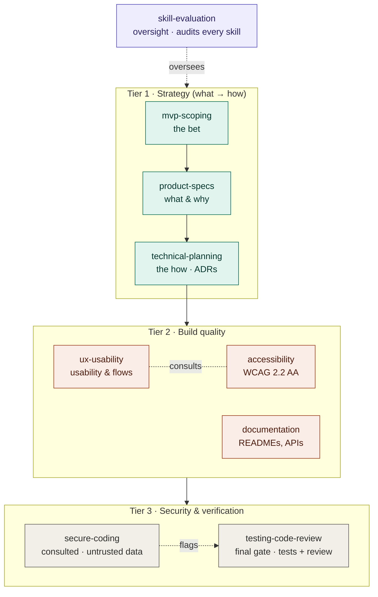

# AI Development — Skills Library

A **living library** of every Claude skill used across the Tech Fleet AI Development
Residency: the full content ("script") of each built skill, plus planned skills mapped
to the weeks that need them. This is the single source of truth for what skills exist,
what they contain, and what's coming next.

> The skill files in `.claude/skills/<name>/SKILL.md` are the **source of truth** — they
> are what Claude loads (and are synced to `~/.claude/skills/` for account-wide use). This
> document is the standard + index that mirrors them for reading, planning, and review.
> **If the two ever disagree, the files win.** When you change a skill, update it here in
> the same commit.

---

- **Folders are flat.** Each skill is `.claude/skills/<name>/SKILL.md`. There are no
  category subfolders — the categories below are an *organizing index*, not directories.
- **Naming:** `lowercase-hyphen`, descriptive, matches the folder name.
- **Status legend:** ✅ built · 🔨 in progress · ⬜ planned

> This section is the **single source of truth** for how a skill is shaped and built.
> Other docs (such as the Week 1 Coding Challenge README) link here instead of repeating it.

### Skill template (canonical)

Every `SKILL.md` opens with **YAML frontmatter** — fenced by `---` above and below — holding
`name` (kebab-case, matches the folder name) and `description`. **Forbidden** anywhere in
frontmatter: angle brackets `< >`, and names starting with `claude` or `anthropic` (both
silently break upload). Optional frontmatter fields: `metadata:` (e.g. `author`, `version`),
`allowed-tools:`, and `license:`.

The body then has the same six core parts, in order (plus an optional seventh):

1. **description** — keyword-rich; what it does *first*, then "Use when…" + triggers; third
   person; ≤1024 chars. This is the *primary* trigger. Claude tends to **under-trigger**
   skills, so make the description a little **"pushy"** — name concrete contexts and phrases
   (e.g. "…use whenever the user mentions X, Y, or Z, even if they don't say 'skill'").
2. **intent** — a one-line statement of what the skill enforces.
3. **numbered rules** — grounded in an authoritative source.
4. **checklist** — "before calling it done".
5. **"when unsure"** — a guardrail for ambiguous cases.
6. **"based on"** — the sources it cites.
7. **examples** *(optional)* — one good/bad pair for skills where the rules need judgment
   (e.g. `ux-usability`, `clean-code`); skip for mechanical skills.

### Authoring principles (canonical)

Grounded in [Anthropic's Skill authoring best practices](https://platform.claude.com/docs/en/agents-and-tools/agent-skills/best-practices):

- **Concise is the #1 rule.** The context window is shared — add only what Claude doesn't
  already know. Challenge every line: "does this justify its token cost?"
- **Match degrees of freedom to the task.** Use *high freedom* (prose, principles) when many
  approaches are valid and judgment matters; *low freedom* (exact steps/scripts, "don't
  modify this command") when a task is fragile and must be done one consistent way.
- **Progressive disclosure — split when a skill outgrows one file.** Keep `SKILL.md` under
  ~500 lines. Past that, move detail into a `references/` folder, link to it **one level
  deep** from `SKILL.md`, and add a table of contents to any reference file over ~100 lines.
  Bundle `scripts/` for deterministic work and `assets/` for output templates when useful.
- **No `README.md` inside a skill folder.** All documentation lives in `SKILL.md` or
  `references/`. (Repo- and week-level READMEs are separate and fine.)

### How skills are built (canonical)

1. **Research first.** Find the *authoritative* source (OWASP, Nielsen, WCAG, Anthropic
   docs, Lean Startup, etc.). Judge source quality — prefer primary/standard sources over
   vendor blogs.
2. **Write on the template above.** Keep it concise — only what Claude doesn't already
   know; body well under 500 lines. *Tip: iterate on one hard task until Claude succeeds,
   then extract the winning approach into the skill — faster signal than broad testing.*
3. **Prove it helps (quick eval).** Before calling it done, run 2–3 realistic test prompts
   the skill targets — once *with* the skill and once *without* it (baseline) — and confirm
   the with-skill version is actually better. The skill should fix a *real* gap, not an
   imagined one. Then **test triggering**: run the skill's own trigger phrases plus 1–2
   paraphrases and confirm it loads, and one unrelated prompt and confirm it does *not* — a
   skill that doesn't fire can't help. (To debug triggering, ask Claude *"When would you use
   the X skill?"* — it quotes the description back, exposing what's missing.)
4. **Review gate — draft in chat first.** Produce the full `SKILL.md` as a draft file
   surfaced in chat. **Nothing lands in the repo yet.** Val reviews it (and may do more
   research), then approves.
5. **Install — only after approval:** (1) create `.claude/skills/<name>/SKILL.md`,
   (2) add a line to [`CLAUDE.md`](../CLAUDE.md), (3) paste its content into this library
   under its category and flip ⬜ to ✅.
   **Definition of done:** the `SKILL.md` file, its entry in this library, and a re-test of
   triggering (it fires on its own phrases plus a paraphrase, and not on an unrelated
   prompt) all land in the **same commit** — never the file alone.
6. **Commit & push** (Val does this hands-on to keep practicing):
   `git add . && git commit -m "Add <name> skill" && git push`

### How the skills relate (governance)

The skills work as a composing team, not a relay race: **no two skills own the same
*decision*, but many skills apply to one *task*.** For any task, one skill is *accountable*
for a concern; others are *consulted* and contribute their slice.

- **Strategy** — `mvp-scoping` → `product-specs` → `technical-planning` (the bet → the
  *what & why* → the *how*); each hands off to the next.
- **Build quality** — `ux-usability`, `accessibility`, `documentation`: consulted on any UI
  or writing.
- **Gate** — `secure-coding` (consulted on untrusted data) → `testing-code-review` (the
  final gate before "done").
- **Oversight** — `skill-evaluation` audits whether each skill still earns its seat.

Rules of thumb: one accountable owner per responsibility; skills compose on a task; beware
over-splitting into trivially-small skills; re-evaluate skills as models and standards
change; enable only the skills a task needs, not the whole library — too many enabled at
once degrades context and triggering. (Progressive disclosure already *loads* selectively
per task; this is about not *enabling* dozens globally — a growing-library concern.)

**The org chart** (solid = hand-off, the next skill becomes accountable; dashed =
consulted / oversight):



---

## Status overview

| Category | Skills | Built |
|---|---|---|
| 1. Product & Planning | mvp-scoping ✅ · product-specs ✅ · technical-planning ✅ | 3 / 3 |
| 2. AI Development | skill-evaluation ✅ · prompt-engineering ⬜ · agentic-workflow-design ⬜ · rag-retrieval ⬜ · ai-evaluation ⬜ · responsible-ai ⬜ | 1 / 6 |
| 3. Design & Experience | ux-usability ✅ · accessibility ✅ | 2 / 2 |
| 4. Code Craft | documentation ✅ · clean-code ⬜ · error-handling-logging ⬜ | 1 / 3 |
| 5. Security & Testing | secure-coding ✅ · testing-code-review ✅ · security-testing ⬜ | 2 / 3 |
| 6. Delivery & Integration | deployment ⬜ · git-workflow ⬜ · api-integration ⬜ · seo-aeo ⬜ | 0 / 4 |

**Total: 9 built · 12 planned**

---

## Residency roadmap (which skill for which week)

| Week | Due | Challenge | Skills |
|---|---|---|---|
| W1 | Oct 19 | GitHub + Skills | the 6 built skills ✅ |
| W2 | Oct 26 | Product Specifications | `mvp-scoping` ✅ · `product-specs` ✅ · `technical-planning` ✅ |
| W3 | Nov 2 | Host a Web App | `deployment` ⬜ · `git-workflow` ⬜ |
| W4 | Nov 9 | AI Chatbot (career coach) | `prompt-engineering` ⬜ · `agentic-workflow-design` ⬜ · `ai-evaluation` ⬜ |
| W5 | Nov 16 | PenTest a Codebase | `secure-coding` ✅ · `security-testing` ⬜ |
| W6 | Nov 30 | PWA + Microservices | `technical-planning` ✅ · `clean-code` ⬜ · `error-handling-logging` ⬜ |
| W7 | Dec 14 | Integrate Apps | `api-integration` ⬜ |
| W8 | Dec 21 | SEO / AEO Strategy | `seo-aeo` ⬜ |

*(`responsible-ai` and `rag-retrieval` slot in wherever the work needs them — likely around W4.)*

---

# The skills

## 1. Product & Planning

### mvp-scoping ✅
*Grounded in: Lean Startup + user stories + MoSCoW · File: `.claude/skills/mvp-scoping/SKILL.md`*

```markdown
---
name: mvp-scoping
description: Enforces disciplined MVP scoping — naming the core assumption to test, capturing needs as user stories, and cutting to the minimum with MoSCoW prioritization — so the first version ships fast and produces real learning. Use when planning a product, defining an MVP, deciding what features to build or cut, writing user stories, or prioritizing a backlog.
---

# MVP / Product Scoping

An MVP is the fastest way to learn whether an idea works with the least effort — not a shrunken version of the final product. Scope around the learning you need, ship it, then decide whether to pivot or persevere. This skill follows the Lean Startup, user stories, and MoSCoW prioritization. Once the MVP is scoped, its stories feed [[product-specs]] (the detailed spec) and [[technical-planning]] (how to build it).

## Start with the assumption, not the features

1. **Name the riskiest assumption first.** Before listing features, state the one belief that must be true for this product to work (e.g. "people will pay to solve X"). You scope the MVP to test *that*.
2. **Define the learning goal.** Decide what evidence would prove or disprove the assumption. The success metric is *learning per effort*, not features shipped.
3. **Consider testing without building.** A landing page, concierge (do it manually), or Wizard-of-Oz test may validate the assumption faster than code. Don't build what a cheaper test could answer.

## Capture needs as user stories

4. **Write stories in the standard form:** "As a [type of user], I want [goal], so that [benefit]." This keeps focus on user value, not implementation.
5. **Add testable acceptance criteria.** Use Given-When-Then and make them specific and measurable — avoid vague words like "fast" or "easy." Cover the main path and the obvious error cases.

## Cut to the minimum with MoSCoW

6. **Sort every story into Must / Should / Could / Won't.**
   - **Must** = the product is pointless without it.
   - **Should** = important but the MVP survives without it.
   - **Could** = nice to have.
   - **Won't** = explicitly out of scope for this release (keep it visible so it doesn't creep back in).
7. **The MVP is the Musts only.** Defer everything else. Scoping is mostly subtraction — when in doubt, cut it.

## Build, measure, learn

8. **Ship the smallest Must-have set, then measure real behavior** — what users *do*, not what they say. Ignore vanity metrics (signups with no engagement).
9. **Decide: pivot or persevere.** Act on the evidence. If the assumption failed, change direction rather than adding more features.

## Checklist before calling the scope "done"

- [ ] The riskiest assumption is written down
- [ ] It's clear what evidence would prove/disprove it
- [ ] Needs are captured as user stories with testable acceptance criteria
- [ ] Every story is tagged Must / Should / Could / Won't
- [ ] The MVP contains only Must-haves
- [ ] There's a defined metric of real user behavior to watch
- [ ] A cheaper non-code test was considered first

## When unsure

If the feature list keeps growing, you've lost the assumption — return to step 1 and re-ask what you're trying to learn. When a feature's priority is debated, default to Won't for this release; it can always come back in the next one.

## Based on

- The Lean Startup (Eric Ries) — MVP and the Build-Measure-Learn loop
- User stories and acceptance criteria (Agile / Mike Cohn), Given-When-Then
- MoSCoW prioritization (DSDM) — Must / Should / Could / Won't
```

### product-specs ✅
*Grounded in: PRD practice + user stories/acceptance criteria · File: `.claude/skills/product-specs/SKILL.md`*

```markdown
---
name: product-specs
description: Enforces clear product specifications (PRDs) — leading with the problem and the user, setting goals and non-goals before features, writing prioritized testable requirements as user stories with acceptance criteria, and defining success metrics and open questions. Use when writing or reviewing a product spec, PRD, feature brief, requirements doc, or acceptance criteria — anything describing WHAT to build and WHY before any code.
---

# Product Specifications (PRD)

A product spec aligns everyone on *what* to build and *why* before anyone writes code. It describes the problem, the user, and the desired outcome — never the implementation. If you can't state the problem, the feature isn't ready. This skill follows established PRD practice and reuses the user-story and acceptance-criteria standards from [[mvp-scoping]].

## Lead with the problem, not the feature

1. **Open with the problem and who has it.** State what's happening today, who feels the pain, and why it's worth solving — backed by evidence (support tickets, data, user quotes) where possible. "Customers miss time-sensitive updates" is a problem; "we need a notification system" is a solution in disguise.
2. **Describe the user and their context.** Name the user type and the situation they're in. Writing "Given [context], the user does [action], the system responds [response], resulting in [outcome]" surfaces edge cases early.

## Set direction before scope

3. **State measurable goals.** Each goal names the outcome that should change, specific enough that you could measure it — not "improve engagement" but a named, observable shift.
4. **State non-goals explicitly.** List 3–5 things this release deliberately does *not* do. Non-goals prevent scope creep as much as goals drive progress; without them, everything looks in scope.

## Write requirements that are testable

5. **Capture requirements as user stories** — "As a [user], I want [goal], so that [benefit]" — describing observable behavior, not intentions. (Same form as [[mvp-scoping]].)
6. **Give each story acceptance criteria.** Use Given-When-Then, specific and measurable. "Search results appear within 2 seconds," not "search should be fast." Cover error states and edge cases, not only the happy path.
7. **Prioritize every requirement.** Label must / should / could (or P0/P1/P2) so the team knows what's essential versus deferrable. Align this with the MoSCoW cut from [[mvp-scoping]] when one exists.

## Keep the "how" out

8. **No implementation details.** Technology, architecture, and data choices belong in [[technical-planning]], not here — unless a technical constraint is a fixed product requirement (e.g. "must work offline"). The PRD is for cross-team alignment on *what*; the technical plan covers *how*.

## Close with metrics and unknowns

9. **Define success metrics with a measurement method,** and add a counter-metric where a metric could be gamed (e.g. "time-on-page up" guarded by "task-completion rate not down").
10. **Record open questions and risks** with an owner for each. Write down what you don't know instead of silently assuming it.
11. **Treat the spec as living and get it reviewed.** Have design and engineering review before it's "final"; update it when the team's understanding changes. Don't write it alone — blind spots go unchallenged.

## Checklist before calling a spec "done"

- [ ] Opens with the problem and who has it, with evidence
- [ ] User type and context are named
- [ ] Goals are measurable; 3–5 non-goals are explicit
- [ ] Requirements are user stories with Given-When-Then acceptance criteria
- [ ] Error states and edge cases are covered, not just the happy path
- [ ] Every requirement is prioritized (must/should/could or P0/P1/P2)
- [ ] No implementation details (those live in the technical plan)
- [ ] Success metrics have a measurement method and a counter-metric
- [ ] Open questions and risks are listed with owners
- [ ] Design and engineering have reviewed it

## When unsure

If a statement describes *how* to build something, it probably belongs in [[technical-planning]] — move it. If you can't write a measurable acceptance criterion for a requirement, the requirement is still too vague — sharpen it before it ships. Prefer a short, clear one-pager over a long one; a longer PRD is not a clearer PRD.

## Based on

- PRD best practices — problem-first structure, goals/non-goals, testable requirements, success metrics, open questions (Marty Cagan / SVPG and common industry PRD practice)
- User stories and acceptance criteria (Agile / Mike Cohn), Given-When-Then — shared with [[mvp-scoping]]
- MoSCoW prioritization (DSDM) — must / should / could
```

### technical-planning ✅
*Grounded in: ADRs (Michael Nygard) + YAGNI · File: `.claude/skills/technical-planning/SKILL.md`*

```markdown
---
name: technical-planning
description: Enforces lightweight technical planning before coding — choosing the simplest stack that fits, recording significant choices as Architecture Decision Records (ADRs) with context, decision, and all consequences, and breaking a feature into small verifiable tasks. Use when choosing a stack or architecture, making a significant technical decision, structuring a project, writing an ADR, or turning a spec into an implementation plan.
---

# Technical Planning

Plan the *how* once the *what* is clear (see [[product-specs]]). Good planning is lightweight: pick the simplest design that meets the requirements, record the decisions that are expensive to reverse, and slice the work into small pieces you can verify. The goal is a plan someone else could pick up — not a large document no one reads.

## Choose the simplest thing that works

1. **Match the stack to the requirements, not the hype.** Prefer tools the team knows and that fit the spec's real constraints (scale, offline, budget, deadline). Boring and familiar beats novel and clever for a first version.
2. **Apply YAGNI — build for today's requirements.** Don't add abstraction, services, or configurability for needs that aren't in the spec yet. Solve the problem in front of you; you can refactor when a real need arrives.
3. **Keep the structure obvious.** Organize the project so a newcomer can find things by convention. Clear boundaries over clever indirection.

## Record significant decisions as ADRs

4. **Write an ADR for each decision that's costly to reverse** — the stack, a datastore, an interface or dependency, a non-functional trade-off. Skip ADRs for trivial, easily-changed choices.
5. **Use Nygard's five parts:** **Title** (names the decision, not the problem), **Status** (proposed / accepted / deprecated / superseded), **Context** (the forces at play — technical, team, time, cost — including the ones in tension), **Decision** (what you will do), **Consequences**.
6. **Record ALL consequences — positive, negative, and neutral.** The negatives are the point: they're the rationale a future reader needs so they don't unknowingly undo the decision. A plan that lists only upsides is hiding the trade-off.
7. **Note the alternatives you considered and why you rejected them.** This is the second-most valuable part of an ADR after the consequences.
8. **Keep ADRs short and in version control** (e.g. an `adr/` or `docs/decisions/` directory, one file per decision). Don't edit an accepted ADR to change the decision — write a new one that supersedes it, preserving the history.

## Break the work into small tasks

9. **Decompose the feature into small, independently verifiable tasks** before coding. Each task should be completable and testable on its own, ideally in a single commit or PR.
10. **Sequence by dependency and risk.** Order tasks so each builds on the last, and tackle the riskiest or most uncertain part early — fail fast while it's cheap to change course.
11. **Define "done" for each task** — what it produces and how you'll know it works (a passing test, a working endpoint). Ties into the verification standard in [[testing-code-review]].

## Checklist before calling a plan "done"

- [ ] The stack fits the spec's real constraints and the team knows it
- [ ] No speculative abstraction or scale built ahead of need (YAGNI)
- [ ] Each costly-to-reverse decision has an ADR
- [ ] Every ADR states context, decision, and ALL consequences (incl. negatives)
- [ ] Alternatives considered are recorded with the reason for rejection
- [ ] ADRs are short and in version control; superseded ones are kept
- [ ] The feature is broken into small, independently verifiable tasks
- [ ] Tasks are sequenced by dependency and risk, riskiest first
- [ ] Each task has a clear definition of "done"

## When unsure

If you're unsure whether a decision needs an ADR, ask whether reversing it later would be expensive — if yes, write one. If you're reaching for a more complex design "in case we need it," that's a YAGNI signal: build the simple version and record the simpler choice as a decision you can revisit. If the *what* is still unclear, stop and fix the spec ([[product-specs]]) before planning the *how*.

## Based on

- Architecture Decision Records — Michael Nygard (2011): Title, Status, Context, Decision, Consequences
- Joel Parker Henderson's ADR collection; lightweight ADR practice (one file per decision, in version control)
- YAGNI / "You Aren't Gonna Need It" and keep-it-simple design principles
- Task decomposition and risk-first sequencing — iterative delivery practice
```

---

## 2. AI Development

### skill-evaluation ✅
*Grounded in: Anthropic skill-creator + Skill authoring best practices · File: `.claude/skills/skill-evaluation/SKILL.md` · Meta-tooling (not tied to a residency week)*

```markdown
---
name: skill-evaluation
description: Evaluates whether a Claude Skill actually works — testing it against a no-skill baseline, writing verifiable assertions, checking triggering accuracy, and iterating on real usage before trusting it. Use whenever creating, reviewing, improving, or deciding whether to keep a skill, whenever writing SKILL.md test cases, or whenever someone asks whether a skill helps, triggers, or is worth its context cost — even if they don't say "evaluate."
---

# Skill Evaluation

A skill is instructions Claude follows blindly, so a weak skill quietly degrades every task that triggers it. Don't trust a skill because it reads well — prove it helps. This skill covers how to evaluate a SKILL before relying on it. Grounded in Anthropic's `skill-creator` and the official Skill authoring best practices.

## Measure against a baseline — this is the core move

1. **Always compare with-skill vs. without-skill.** Run the same realistic task twice: once with the skill loaded, once with no skill (baseline). The skill earns its place only if the with-skill output is clearly better. A skill that doesn't beat baseline is noise.
2. **Be evaluation-driven: write the evals before writing lots of content.** First run Claude on representative tasks *without* the skill and note the specific failures. Build the skill to fix *those real gaps*, not imagined ones.

## Write test cases a real user would actually type

3. **Use 2–3 concrete, realistic prompts** — with specifics (file names, column values, context, casual phrasing), not abstract stubs like "format this data." The skill must work for the unseen thousandth case, so the prompts should represent the real distribution, not your favorite example.
4. **Write objectively verifiable assertions where the output allows it** (a file was produced, it contains X, the format matches, the number is correct). For subjective skills (writing style, design, tone), prefer human judgment — don't force brittle assertions onto things that need taste.

## Test triggering separately from quality

5. **The description is the primary trigger — test it on its own.** Create should-trigger and should-**not**-trigger queries. The valuable negatives are *near-misses* (share keywords but need something else), not obviously-unrelated prompts.
6. **Watch for under-triggering.** Claude tends to skip skills it would benefit from, and only consults skills for tasks it can't easily handle alone. If a good skill rarely fires, the fix is almost always the **description**, not the body.

## Judge cost, not just correctness

7. **Weigh quality against tokens and time.** A skill that helps a little but bloats context or slows the task may not be worth it. Read the transcripts, not just the final output — if the skill makes Claude waste steps, cut the parts causing it.

## Iterate on observed behavior, then decide

8. **Improve from how a fresh Claude actually uses the skill** (the "Claude A writes / Claude B uses" pattern). Generalize from feedback — fix the underlying issue, don't overfit tweaks to your handful of test cases.
9. **Test on the model(s) you'll actually use.** Haiku may need more guidance than Opus; what works for one can under- or over-explain for another.
10. **Record a verdict: keep, revise, or cut.** State the evidence. Revising the description fixes triggering; revising the body fixes behavior; cutting is the right call when the skill doesn't beat baseline.

## Checklist before trusting a skill

- [ ] 2–3 realistic test prompts (what a real user would type)
- [ ] A no-skill baseline run to compare against
- [ ] Assertions are objectively verifiable (or qualitative if the output is subjective)
- [ ] Triggering tested: should-trigger **and** near-miss should-not-trigger queries
- [ ] Tested on the model(s) actually in use
- [ ] Quality weighed against token/time cost (transcripts read, not just outputs)
- [ ] Improvements generalize — not overfit to the test prompts
- [ ] Verdict recorded: keep / revise / cut, with evidence

## When unsure

If the skill's output is subjective, trust human review over invented metrics. If the skill helps but rarely triggers, change the description before touching the body. And if two iterations don't make it beat baseline, cutting it is a valid, often correct outcome — a skill that doesn't earn its context is worse than none.

## Based on

- Anthropic `skill-creator` — draft → test (with-skill vs. baseline) → review → iterate → description optimization
- Skill authoring best practices — evaluation-driven development, triggering, degrees of freedom, cost (platform.claude.com/docs/en/agents-and-tools/agent-skills/best-practices)
```

### prompt-engineering ⬜ *(planned — Week 4, due Nov 9)*
Intended scope: writing effective prompts for the Claude API — clear role/task/context,
output format, few-shot examples, constraints, and testing across inputs.
*Likely grounded in: Anthropic prompt engineering guidance.*

### agentic-workflow-design ⬜ *(planned — Week 4)*
Intended scope: designing multi-step agent loops (plan → retrieve → draft → self-critique
→ revise), tool use, and guardrails.
*Likely grounded in: agent design patterns + Anthropic agent guidance.*

### rag-retrieval ⬜ *(planned — around Week 4)*
Intended scope: retrieval-augmented generation — chunking, embeddings, grounding answers
in sources, and avoiding hallucination.
*Likely grounded in: RAG best practices.*

### ai-evaluation ⬜ *(planned — Week 4)*
Intended scope: evaluating LLM *outputs* (distinct from code tests) — eval sets,
rubrics, LLM-as-judge, and regression checks for prompts/agents.
*Likely grounded in: LLM evaluation practices.*

### responsible-ai ⬜ *(planned — around Week 4)*
Intended scope: responsible-AI practices — provenance/sourcing, human review, bias and
safety checks, transparency about AI-generated content.
*Likely grounded in: NIST AI RMF.*

---

## 3. Design & Experience

### ux-usability ✅
*Grounded in: Nielsen's heuristics + enterprise UX · File: `.claude/skills/ux-usability/SKILL.md`*

```markdown
---
name: ux-usability
description: Designs clear, efficient, role-aware user experiences grounded in Nielsen's usability heuristics and enterprise UX principles. Use when designing or building any user-facing interface, screen, form, flow, navigation, button, dashboard, or interaction — websites, apps, enterprise tools, or CLI output.
---

# UX / Usability

Good UX means users accomplish their goal with minimum confusion and effort. Design for the person using it, not for the person building it. This skill is grounded in Jakob Nielsen's 10 Usability Heuristics (Nielsen Norman Group) and enterprise UX best practices.

## Core rules (usability foundations)

1. **Make the next step obvious.** The primary action on any screen should be the most visually prominent. Don't make users hunt.
2. **Give feedback (visibility of system status).** Every action gets a visible response — loading states, success confirmations, and clear error messages that say what to do next.
3. **Match the real world.** Use words and concepts your users already know. "Save changes," not "Submit." Avoid internal jargon.
4. **Prevent errors before they happen.** Use sensible defaults, constrain inputs (date pickers, dropdowns), and confirm destructive actions.
5. **Recognition over recall.** Keep key options visible so users don't have to remember hidden steps.
6. **User control and freedom.** Let users undo actions and exit flows easily — provide a clear way out.
7. **Be consistent.** Same words, colors, and patterns for the same things throughout, ideally via a shared design system.
8. **Reduce effort.** Pre-fill what you can, keep forms short, ask only for what's needed, and remember user choices.

## Enterprise-specific rules

9. **Design for whole workflows, not single screens.** Enterprise tasks span many steps, roles, and systems. Map the end-to-end journey before designing any one screen.
10. **Tailor views to roles.** Show each user only what their job and permissions require — role-based views reduce clutter and mistakes.
11. **Favor efficiency over visual flair.** Enterprise users are often power users doing repetitive work; optimize for speed and accuracy, not decoration.
12. **Follow familiar patterns (Jakob's Law).** Users spend most of their time in other software and expect yours to behave similarly. Reuse established patterns to cut the learning curve.

## Checklist before calling UX "done"

- [ ] The main action on each screen is clear and prominent
- [ ] Every action gives visible feedback (loading / success / error)
- [ ] Error messages explain how to fix the problem
- [ ] Destructive actions require confirmation and can be undone
- [ ] Labels and buttons use plain, consistent language
- [ ] Forms ask only for what is necessary
- [ ] The design supports the full workflow, not just one screen
- [ ] Each role sees only what it needs
- [ ] Familiar, consistent patterns are used throughout

## When unsure

If a design trade-off affects how easily real users succeed (layout, wording, flow length, role permissions), flag it and suggest the simpler, lower-effort option. When possible, recommend testing with a real user over guessing.

## Based on

- Jakob Nielsen's 10 Usability Heuristics — Nielsen Norman Group (nngroup.com)
- Jakob's Law of the Internet User Experience
- Enterprise UX best practices: workflow-first design, role-based views, efficiency for power users
```

### accessibility ✅
*Grounded in: WCAG 2.2 AA / POUR · File: `.claude/skills/accessibility/SKILL.md`*

```markdown
---
name: accessibility
description: Enforces accessible interfaces that work for people with disabilities, following WCAG 2.2 Level AA and the POUR principles — text alternatives, keyboard operability, color contrast, semantic HTML, and screen-reader support. Use when building or reviewing any UI, HTML, component, form, image, color choice, or interaction that a person will see or operate.
---

# Accessibility

Build interfaces usable by everyone, including people who use screen readers, keyboards only, or need high contrast. Accessibility is a requirement, not an enhancement. This skill follows WCAG 2.2 Level AA, organized by the four POUR principles.

## Perceivable — users can sense the content

1. **Provide text alternatives.** Give meaningful images descriptive `alt` text; mark decorative images with empty `alt=""`. Label icon-only buttons with an accessible name (`aria-label`).
2. **Caption and transcribe media.** Provide captions for video and transcripts for audio.
3. **Meet color contrast minimums.** At least 4.5:1 for normal text, 3:1 for large text. Never use color as the *only* way to convey meaning — back it up with text, icons, or labels.

## Operable — everything works without a mouse

4. **Full keyboard access.** Every interactive element must be reachable and usable by keyboard alone. No keyboard traps.
5. **Visible focus.** Keep a clear focus indicator, and make focus order match the logical reading order. Manage focus when dialogs open and close.
6. **No seizure triggers.** Nothing flashes more than three times per second.

## Understandable — users comprehend the interface

7. **Label every form field.** Associate a visible label with each input, and link error and hint messages programmatically (`aria-describedby`, `aria-invalid`).
8. **Be predictable and clear.** Consistent navigation and labels across pages, clear instructions, and error messages that explain how to fix the problem.
9. **Declare page language and a descriptive title.**

## Robust — works with assistive technology

10. **Prefer semantic HTML.** Use native elements for their purpose — `<button>` for actions, `<a>` for navigation, properly nested headings, landmark regions. Reach for ARIA only when HTML falls short, and keep ARIA states current (`aria-expanded`, etc.).

## Checklist before calling accessibility "done"

- [ ] All meaningful images have alt text; decorative ones have `alt=""`
- [ ] Icon-only controls have accessible names
- [ ] Text contrast meets 4.5:1 (3:1 for large text)
- [ ] Meaning is never conveyed by color alone
- [ ] Every feature works with the keyboard, with visible focus
- [ ] Every form field has a label; errors are linked programmatically
- [ ] Semantic HTML is used; ARIA only where needed
- [ ] Tested with a keyboard and a screen reader, not just automated tools

## When unsure

Automated scanners catch only part of the issues. If an interaction is complex (custom widgets, dynamic content, focus management), flag it for manual keyboard and screen-reader testing rather than assuming it passes. Make accessibility part of the definition of done.

## Based on

- WCAG 2.2 Level AA — W3C Web Content Accessibility Guidelines (w3.org/WAI)
- POUR principles: Perceivable, Operable, Understandable, Robust
```

---

## 4. Code Craft

### documentation ✅
*Grounded in: Diátaxis + Google/Chromium doc practices · File: `.claude/skills/documentation/SKILL.md`*

```markdown
---
name: documentation
description: Enforces clear, maintainable documentation — READMEs, code comments, and API/reference docs — using the Diátaxis framework and proven developer-doc practices so others can understand and maintain the code. Use when writing or updating a README, docstrings, code comments, API references, guides, or any explanation of how code works or how to use it.
---

# Documentation

Good documentation lets someone else (including future you) understand and use the code without asking. Write for the reader, keep it current, and match each piece to its purpose. This skill follows the Diátaxis framework and established developer-documentation practices.

## Know which of the four doc types you are writing (Diátaxis)

1. **Keep the four types separate — don't mix them.**
   - **Tutorial** (learning): a step-by-step path for a newcomer to a concrete result.
   - **How-to guide** (a task): concise steps for someone who knows the basics and wants one job done.
   - **Reference** (facts): dry, complete, accurate details of the machinery — no teaching.
   - **Explanation** (understanding): the background and the *why* behind a design.
2. **Don't let one type creep into another.** The common failure is explanation leaking into a how-to guide — move it to its own page and link instead.

## READMEs

3. **Lead with purpose.** Say what the project does and the problem it solves *before* installation steps.
4. **Orient the newcomer.** Cover what's here, which files to read first, how to set it up and run it, and who maintains it.

## Comments and API docs

5. **Comments explain *why*, not *what*.** The code already shows what it does; comments add the reasoning the code can't express. Remove or update stale comments and TODOs.
6. **Treat API/reference docs as the contract.** For each function or method, document its arguments, return value, errors/exceptions, and any restrictions. Documented behavior should ideally have a test verifying it.
7. **Show the simplest use case first** in class/module overviews, with a short example.

## Keep it maintainable

8. **Fight drift — keep docs current.** Update documentation in the same change as the code it describes. Outdated docs are worse than none.
9. **Don't duplicate; link.** Don't rewrite a guide to a common tool or process — link to the existing one.

## Checklist before calling documentation "done"

- [ ] Each page is clearly one Diátaxis type, not a mix
- [ ] The README leads with what the project does and why
- [ ] Setup/run steps and maintainer are included
- [ ] Comments explain *why*; stale comments/TODOs are cleaned up
- [ ] API docs list arguments, returns, and errors
- [ ] Docs were updated alongside the code change
- [ ] No duplicated content that could drift — linked instead

## When unsure

If you can't tell which doc type a page is, it is probably mixing two — split it. If documenting a complex or non-obvious design decision, capture the *why* in an explanation doc so the reasoning isn't lost.

## Based on

- Diátaxis framework (Daniele Procida) — tutorials, how-to guides, reference, explanation (diataxis.fr)
- Developer documentation best practices — Google/Chromium engineering docs
```

### clean-code ⬜ *(planned — Week 6, due Nov 30)*
Intended scope: readable, maintainable code — clear naming, small focused functions,
no duplication, consistent structure, and avoiding premature complexity.
*Likely grounded in: Clean Code principles + language style guides.*

### error-handling-logging ⬜ *(planned — Week 6)*
Intended scope: robust failure handling — meaningful errors, graceful degradation,
structured logging, and never swallowing exceptions silently.
*Likely grounded in: production reliability / observability practices.*

---

## 5. Security & Testing

### secure-coding ✅
*Grounded in: OWASP Top 10 · File: `.claude/skills/secure-coding/SKILL.md`*

```markdown
---
name: secure-coding
description: Enforces secure coding defenses against the OWASP Top 10 — access control, encryption, injection prevention, safe secrets handling, and input validation. Use when writing, reviewing, or modifying code that handles user input, authentication, passwords, secrets, API keys, access control, file uploads, database queries, external requests, or data from any untrusted source.
---

# Secure Coding

Apply these practices whenever code touches untrusted input, credentials, access decisions, or sensitive data. Security is not a final step — build it in from the first line. This skill is grounded in the OWASP Top 10 and OWASP Secure Coding Practices.

## Core rules (mapped to the OWASP Top 10)

1. **Enforce access control on every request (A01 — the #1 risk).** Check that the user is authorized for the specific action and resource, server-side, every time. Deny by default. Never rely on hiding a button in the UI.
2. **Protect sensitive data with strong cryptography (A02).** Encrypt sensitive data in transit (HTTPS/TLS) and at rest. Hash passwords with a strong, salted algorithm (bcrypt, argon2, scrypt). Never store or log raw passwords.
3. **Prevent injection (A03).** Use parameterized queries / prepared statements — never concatenate user input into SQL or commands. Escape user data shown in HTML to prevent XSS.
4. **Design securely from the start (A04).** Validate all input (type, length, format, range). Think through how a feature could be abused before building it; flag risky flows early.
5. **Configure securely (A05).** Use secure defaults, disable debug/verbose errors in production, remove default accounts, and never commit secrets — read them from environment variables or a secrets manager, and keep them in `.gitignore`.
6. **Keep components updated (A06).** Use maintained libraries, track dependencies, and update when known vulnerabilities (CVEs) are reported. Avoid unmaintained packages.
7. **Authenticate and manage sessions safely (A07).** Enforce strong authentication, protect against brute force, expire sessions, and support multi-factor auth where it matters.
8. **Log and monitor security events (A09) — but never log secrets.** Record auth successes/failures and access-control failures so incidents can be detected. Keep passwords, tokens, and personal data out of logs.
9. **Fail securely and least privilege.** On error, deny access and reveal nothing sensitive. Give every user, service, and process the minimum access it needs.

## Checklist before calling security "done"

- [ ] Every sensitive action checks authorization server-side (access control)
- [ ] Sensitive data is encrypted in transit and at rest
- [ ] All queries are parameterized; output is escaped
- [ ] All external input is validated before use
- [ ] No secrets in the code or git history
- [ ] Dependencies are current and free of known vulnerabilities
- [ ] Passwords are hashed with a strong algorithm; sessions expire
- [ ] Security events are logged, and logs contain no secrets
- [ ] Errors reveal nothing sensitive and deny by default

## When unsure

If a security decision is non-obvious (crypto choices, auth flows, access-control design, handling regulated data), say so explicitly and recommend a security review rather than guessing. It is better to flag a risk than to hide it.

## Based on

- OWASP Top 10 (2021) — owasp.org/Top10
- OWASP Secure Coding Practices — Quick Reference Guide
```

### testing-code-review ✅
*Grounded in: Testing Pyramid + Google review practices · File: `.claude/skills/testing-code-review/SKILL.md`*

```markdown
---
name: testing-code-review
description: Enforces meaningful automated testing (testing pyramid) and rigorous code review (Google's review priorities) so changes are correct, maintainable, and verified before they ship. Use when writing tests, reviewing a pull request or diff, checking a change for bugs, or deciding whether code is ready to merge.
---

# Testing & Code Review

Quality comes from verifying work, not assuming it. This skill covers two jobs: writing automated tests (based on the testing pyramid) and reviewing code (based on Google's engineering practices). Apply them before calling any change "done."

## Writing tests — follow the testing pyramid

1. **Many unit tests at the base.** Fast, isolated tests for individual functions and components. These are cheap and stable — write the most of these.
2. **Fewer integration tests in the middle.** Test how parts work together (code + database/API) with realistic data. Cover both the happy path and error paths.
3. **A few end-to-end tests at the top.** Cover only critical user journeys — E2E tests are slow and brittle, so keep them focused.
4. **Test meaningfully, not for a number.** Don't chase 100% coverage with empty tests. A good test fails when the behavior actually breaks.
5. **Keep tests deterministic.** No flaky tests from timing, order, or external state. Automate all layers so they run in CI on every change.

## Reviewing code — Google's priorities, in order

6. **Design first.** Does the change fit the system? Does it belong here? Is it the right approach?
7. **Functionality.** Does it do what was intended, for both end-users and future developers? Are edge cases and error conditions handled?
8. **Complexity.** Can each piece be understood quickly? Is it over-engineered or solving problems that don't exist yet? Simpler is better.
9. **Tests.** Are there appropriate tests, and would they actually fail if the code broke?
10. **Naming, comments, consistency.** Clear, descriptive names. Comments explain *why*, not *what*. Code matches the surrounding style and conventions.
11. **Review every line, in context.** Understand each change; look beyond the diff at the whole file. Ask for clarification on anything unclear. Flag that specialized areas (security, concurrency) get a qualified review.
12. **Acknowledge good work.** Call out improvements and good practices, not only problems.

## Checklist before calling a change "done"

- [ ] Unit tests cover the core logic; integration tests cover key interactions
- [ ] Critical user paths have an end-to-end test
- [ ] Tests are meaningful and would fail if the behavior broke
- [ ] Tests are deterministic and run in CI
- [ ] The design fits the system and is no more complex than needed
- [ ] Edge cases and error paths are handled
- [ ] Names are clear; comments explain why; style is consistent
- [ ] Every changed line is understood, not just skimmed

## When unsure

If a change touches a specialized or high-risk area (security, concurrency, data integrity), say so and recommend a qualified reviewer rather than approving on general grounds. Prefer flagging a gap over waving a change through.

## Based on

- The Testing Pyramid (Mike Cohn) — unit / integration / end-to-end balance
- Google Engineering Practices — "What to look for in a code review" (google.github.io/eng-practices)
```

### security-testing ⬜ *(planned — Week 5, due Nov 16)*
Intended scope: finding vulnerabilities in a codebase — threat modeling, testing against
the OWASP Top 10, dependency/secret scanning, and safe, authorized pentesting practice.
*Likely grounded in: OWASP Testing Guide + OWASP Top 10.*

---

## 6. Delivery & Integration

### deployment ⬜ *(planned — Week 3, due Nov 2)*
Intended scope: getting an app live — hosting, environment variables/config, build steps,
and basic CI so deploys are repeatable.
*Likely grounded in: Twelve-Factor App.*

### git-workflow ⬜ *(planned — Week 3)*
Intended scope: a clean version-control workflow — branches, meaningful commits, pull
requests, `.gitignore` hygiene, and commit ≠ push discipline.
*Likely grounded in: Git flow / trunk-based development basics.*

### api-integration ⬜ *(planned — Week 7, due Dec 14)*
Intended scope: connecting apps and services — consuming REST APIs, handling auth, rate
limits, retries, and failures gracefully.
*Likely grounded in: REST / API integration best practices.*

### seo-aeo ⬜ *(planned — Week 8, due Dec 21)*
Intended scope: making an app discoverable by search engines and answer engines — meta
tags, structured data, performance, and content structured for AI answer extraction.
*Likely grounded in: SEO fundamentals + AEO (answer engine optimization) practices.*
