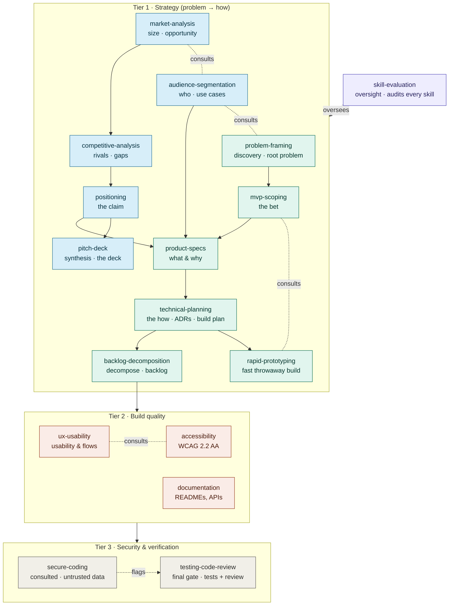

# AI Development — Skills Library

A **living library** of every Claude skill used across the Tech Fleet AI Development
Residency: the full content ("script") of each built skill, plus planned skills mapped
to the weeks that need them. This is the single source of truth for what skills exist,
what they contain, and what's coming next.

> The skill files in `.claude/skills/<name>/SKILL.md` are the **source of truth** — they
> are what Claude loads (and are synced to `~/.claude/skills/` for account-wide use). This
> document is the standard + index that mirrors them for reading, planning, and review.
> **If the two ever disagree, the files win.** When you change a skill, update it here in
> the same commit.

---

- **Folders are flat.** Each skill is `.claude/skills/<name>/SKILL.md`. There are no
  category subfolders — the categories below are an *organizing index*, not directories.
- **Naming:** `lowercase-hyphen`, descriptive, matches the folder name.
- **Status legend:** ✅ built · 🔨 in progress · ⬜ planned

> This section is the **single source of truth** for how a skill is shaped and built.
> Other docs (such as the Week 1 Coding Challenge README) link here instead of repeating it.

### Skill template (canonical)

Every `SKILL.md` opens with **YAML frontmatter** — fenced by `---` above and below — holding
`name` (kebab-case, matches the folder name) and `description`. **Forbidden** anywhere in
frontmatter: angle brackets `< >`, and names starting with `claude` or `anthropic` (both
silently break upload). Optional frontmatter fields: `metadata:` (e.g. `author`, `version`),
`allowed-tools:`, and `license:`.

The body then has the same six core parts, in order (plus an optional seventh):

1. **description** — keyword-rich; what it does *first*, then "Use when…" + triggers; third
   person; ≤1024 chars. This is the *primary* trigger. Claude tends to **under-trigger**
   skills, so make the description a little **"pushy"** — name concrete contexts and phrases
   (e.g. "…use whenever the user mentions X, Y, or Z, even if they don't say 'skill'").
2. **intent** — labeled with a `## Intent` heading right after the H1: 1–3 sentences stating
   what the skill enforces and the source it's grounded in.
3. **numbered rules** — grounded in an authoritative source.
4. **checklist** — "before calling it done".
5. **"when unsure"** — a guardrail for ambiguous cases.
6. **"based on"** — the sources it cites.
7. **examples** *(optional)* — one good/bad pair for skills where the rules need judgment
   (e.g. `ux-usability`, `clean-code`); skip for mechanical skills.

### Authoring principles (canonical)

Grounded in [Anthropic's Skill authoring best practices](https://platform.claude.com/docs/en/agents-and-tools/agent-skills/best-practices):

- **Concise is the #1 rule.** The context window is shared — add only what Claude doesn't
  already know. Challenge every line: "does this justify its token cost?"
- **Match degrees of freedom to the task.** Use *high freedom* (prose, principles) when many
  approaches are valid and judgment matters; *low freedom* (exact steps/scripts, "don't
  modify this command") when a task is fragile and must be done one consistent way.
- **Progressive disclosure — split when a skill outgrows one file.** Keep `SKILL.md` under
  ~500 lines. Past that, move detail into a `references/` folder, link to it **one level
  deep** from `SKILL.md`, and add a table of contents to any reference file over ~100 lines.
  Bundle `scripts/` for deterministic work and `assets/` for output templates when useful.
- **No `README.md` inside a skill folder.** All documentation lives in `SKILL.md` or
  `references/`. (Repo- and week-level READMEs are separate and fine.)

### How skills are built (canonical)

1. **Research first.** Find the *authoritative* source (OWASP, Nielsen, WCAG, Anthropic
   docs, Lean Startup, etc.). Judge source quality — prefer primary/standard sources over
   vendor blogs.
2. **Write on the template above.** Keep it concise — only what Claude doesn't already
   know; body well under 500 lines. *Tip: iterate on one hard task until Claude succeeds,
   then extract the winning approach into the skill — faster signal than broad testing.*
3. **Prove it helps (quick eval).** Before calling it done, run 2–3 realistic test prompts
   the skill targets — once *with* the skill and once *without* it (baseline) — and confirm
   the with-skill version is actually better. The skill should fix a *real* gap, not an
   imagined one. Then **test triggering**: run the skill's own trigger phrases plus 1–2
   paraphrases and confirm it loads, and one unrelated prompt and confirm it does *not* — a
   skill that doesn't fire can't help. (To debug triggering, ask Claude *"When would you use
   the X skill?"* — it quotes the description back, exposing what's missing.)
4. **Review gate — draft in chat first.** Produce the full `SKILL.md` as a draft file
   surfaced in chat. **Nothing lands in the repo yet.** Val reviews it (and may do more
   research), then approves.
5. **Install — only after approval:** (1) create `.claude/skills/<name>/SKILL.md`,
   (2) add a line to [`CLAUDE.md`](../CLAUDE.md), (3) paste its content into this library
   under its category and flip ⬜ to ✅.
   **Definition of done:** the `SKILL.md` file, its entry in this library, and a re-test of
   triggering (it fires on its own phrases plus a paraphrase, and not on an unrelated
   prompt) all land in the **same commit** — never the file alone.
6. **Commit & push** (Val does this hands-on to keep practicing):
   `git add . && git commit -m "Add <name> skill" && git push`

### How the skills relate (governance)

The skills work as a composing team, not a relay race: **no two skills own the same
*decision*, but many skills apply to one *task*.** For any task, one skill is *accountable*
for a concern; others are *consulted* and contribute their slice.

- **Strategy** — `problem-framing` → `mvp-scoping` → `product-specs` → `technical-planning`
  (the problem → the bet → the *what & why* → the *how*); each hands off to the next.
  This is a **dependency** order run **iteratively**, not fixed phases — the authoritative
  full pipeline (incl. discovery → mvp-scoping and backlog → build plan) lives in
  [`CLAUDE.md`](../CLAUDE.md) under "The product-spec pipeline."
- **Discovery & market** — `audience-segmentation` (who), then `market-analysis` →
  `competitive-analysis` → `positioning` — all feed `product-specs`.
- **Build quality** — `ux-usability`, `accessibility`, `documentation`: consulted on any UI
  or writing.
- **Gate** — `secure-coding` (consulted on untrusted data) → `testing-code-review` (the
  final gate before "done").
- **Oversight** — `skill-evaluation` audits whether each skill still earns its seat.

Rules of thumb: one accountable owner per responsibility; skills compose on a task; beware
over-splitting into trivially-small skills; re-evaluate skills as models and standards
change; enable only the skills a task needs, not the whole library — too many enabled at
once degrades context and triggering. (Progressive disclosure already *loads* selectively
per task; this is about not *enabling* dozens globally — a growing-library concern.)

**The org chart** (solid = hand-off, the next skill becomes accountable; dashed =
consulted / oversight):

---

## Status overview

| Category | Skills | Built |
|---|---|---|
| 1. Product & Planning | problem-framing ✅ · mvp-scoping ✅ · product-specs ✅ · technical-planning ✅ · rapid-prototyping ✅ · backlog-decomposition ✅ · audience-segmentation ✅ · market-analysis ✅ · competitive-analysis ✅ · positioning ✅ · pitch-deck ✅ | 11 / 11 |
| 2. AI Development | skill-evaluation ✅ · prompt-engineering ⬜ · agentic-workflow-design ⬜ · rag-retrieval ⬜ · ai-evaluation ⬜ · responsible-ai ⬜ | 1 / 6 |
| 3. Design & Experience | ux-usability ✅ · accessibility ✅ | 2 / 2 |
| 4. Code Craft | documentation ✅ · clean-code ⬜ · error-handling-logging ⬜ | 1 / 3 |
| 5. Security & Testing | secure-coding ✅ · testing-code-review ✅ · security-testing ⬜ | 2 / 3 |
| 6. Delivery & Integration | deployment ⬜ · git-workflow ⬜ · api-integration ⬜ · seo-aeo ⬜ | 0 / 4 |

**Total: 17 built · 12 planned**

---

## Residency roadmap (which skill for which week)

| Week | Due | Challenge | Skills |
|---|---|---|---|
| W1 | Oct 19 | GitHub + Skills | the 6 built skills ✅ |
| W2 | Oct 26 | Product Specifications | `problem-framing` ✅ · `mvp-scoping` ✅ · `product-specs` ✅ · `technical-planning` ✅ · `backlog-decomposition` ✅ · `audience-segmentation` ✅ · `market-analysis` ✅ · `competitive-analysis` ✅ · `positioning` ✅ · `pitch-deck` ✅ |
| W3 | Nov 2 | Host a Web App | `rapid-prototyping` ✅ · `deployment` ⬜ · `git-workflow` ⬜ |
| W4 | Nov 9 | AI Chatbot (career coach) | `prompt-engineering` ⬜ · `agentic-workflow-design` ⬜ · `ai-evaluation` ⬜ |
| W5 | Nov 16 | PenTest a Codebase | `secure-coding` ✅ · `security-testing` ⬜ |
| W6 | Nov 30 | PWA + Microservices | `technical-planning` ✅ · `clean-code` ⬜ · `error-handling-logging` ⬜ |
| W7 | Dec 14 | Integrate Apps | `api-integration` ⬜ |
| W8 | Dec 21 | SEO / AEO Strategy | `seo-aeo` ⬜ |

*(`responsible-ai` and `rag-retrieval` slot in wherever the work needs them — likely around W4.)*

---

# The skills

> Each **built** skill links to its `SKILL.md` — the source of truth. Planned skills show intended scope. (This is an index, not a copy, so it cannot drift.)

## 1. Product & Planning

### problem-framing ✅
*Grounded in: Tech Fleet Product Requirements Masterclass + 5 Whys · [`SKILL.md`](../.claude/skills/problem-framing/SKILL.md)*

Discovery before solutions: dig to the ROOT (5 Whys), break the problem into aspects, write a formal problem statement + problem checklist, and convert it to a user story. The new front of the strategy chain — feeds [[mvp-scoping]] and [[product-specs]].

### mvp-scoping ✅
*Grounded in: Lean Startup + user stories + MoSCoW + Tech Fleet Vision/Scope/Roadmap workshop · [`SKILL.md`](../.claude/skills/mvp-scoping/SKILL.md)*

The riskiest-assumption bet → user stories → a MoSCoW cut → stage into **MVP vs MMP** (Risk×Certainty + Effort×Value) → vision board per audience per release → scope-of-outcomes table. Keeps release claims matched to scope; leading vs lagging KPIs. Feeds [[product-specs]], [[technical-planning]], and [[backlog-decomposition]].

### product-specs ✅
*Grounded in: PRD practice + user stories/acceptance criteria · [`SKILL.md`](../.claude/skills/product-specs/SKILL.md)*

The *what & why*: problem-first PRDs, testable user-story requirements, success metrics. Reuses [[mvp-scoping]]; defers the *how* to [[technical-planning]].

### technical-planning ✅
*Grounded in: ADRs (Michael Nygard) + YAGNI + agile build-plan (non-functional before functional) + BDD + INVEST · [`SKILL.md`](../.claude/skills/technical-planning/SKILL.md)*

The *how*, end to end: the simplest stack that fits + ADRs that record all consequences; the **build plan** — sequence the build non-functional-before-functional (tooling → data → architecture → security → DevOps → QA → features) with a dependency spine and a walking skeleton; and the **delivery specs** — non-functional requirements ("shall" + binary pass/fail verification) and task-level technical requirements (acceptance + BDD + API/data-flow + UI). Plans what [[product-specs]] defined; hands the work breakdown to [[backlog-decomposition]].

### rapid-prototyping ✅
*Grounded in: Throwaway prototyping (Brooks, McConnell) + Wizard-of-Oz for AI + startup prototyping-speed study · [`SKILL.md`](../.claude/skills/rapid-prototyping/SKILL.md)*

The build craft: make a rough working version fast to answer *one* question, then throw it away. Fidelity by the question (low early, high only once a flow is settled or trust is under test), happy path only, reuse components/design systems, fake data/integrations and the AI (Wizard-of-Oz), spend effort on the uncertain part, and rebuild — never promote — for production. Executes what [[mvp-scoping]] scoped; hands a graduating prototype to [[technical-planning]] and [[secure-coding]]; testing it is [[ux-usability]].

### backlog-decomposition ✅
*Grounded in: SAFe epic/feature/story hierarchy + INVEST (Bill Wake) + Scrum refinement + Kanban (Anderson) · [`SKILL.md`](../.claude/skills/backlog-decomposition/SKILL.md)*

Organizes a defined scope into an Epic → Feature → Task hierarchy and a groomed, prioritized backlog / Kanban board. Owns the work-breakdown *structure* (clustering, altitude, granularity, single-home for cross-cutting capabilities, board tags, dependency/risk order); consults [[product-specs]] (feature stories + ACs), [[technical-planning]] (task breakdown), and [[mvp-scoping]] (the MoSCoW cut).

### audience-segmentation ✅
*Grounded in: Tech Fleet Audience Segmentation Workshop · [`SKILL.md`](../.claude/skills/audience-segmentation/SKILL.md)*

*Who* and *which use cases*: segment across four lenses → focus audiences (label + traits) → motivations → situational/life goals → the use-case table (problem aspect → when today → business goal → future scenario), in tight sticky phrasing. Consults [[problem-framing]] (roots, no-solutions); feeds [[mvp-scoping]] and [[product-specs]].

### market-analysis ✅
*Grounded in: Tech Fleet Market Research Workshop + TAM/SAM/SOM · [`SKILL.md`](../.claude/skills/market-analysis/SKILL.md)*

Sizes and shapes the opportunity: market segments (categories, primary vs adjacent) → size (sourced ranges, no invented precision; headline TAM vs the real addressable *intersection*) → opportunity (big enough + not too crowded = whitespace). Consults [[audience-segmentation]] (who); feeds [[competitive-analysis]] and [[product-specs]].

### competitive-analysis ✅
*Grounded in: Tech Fleet Market Research Workshop + competitive-analysis practice · [`SKILL.md`](../.claude/skills/competitive-analysis/SKILL.md)*

Studies who else solves the problem to find the gap: direct/indirect (by *customer overlap*) ranked by product similarity → questions that test differentiation → comparison table → feature grid (provided-vs-DIY lens ✅/⚠️/🚫; table-stakes vs differentiators; only griddable products, non-products become positioning notes) → whitespace. Consults [[market-analysis]]; feeds [[positioning]] and [[product-specs]].

### positioning ✅
*Grounded in: Geoffrey Moore (Crossing the Chasm) + Tech Fleet Market Research Workshop · [`SKILL.md`](../.claude/skills/positioning/SKILL.md)*

One sharp, defensible claim: *For [audience] who [need], [product] is a [category] that [benefit] — unlike [alternative], which [gap].* Reuses audiences + gaps (doesn't re-derive), leads with differentiated *impact* not features, one audience + one benefit, concedes table-stakes. Consults [[audience-segmentation]] and [[competitive-analysis]]; feeds [[product-specs]] and [[pitch-deck]].

### pitch-deck ✅
*Grounded in: Guy Kawasaki 10/20/30 + Sequoia pitch arc + Rockefeller "Digital Storytelling for Social Impact" · [`SKILL.md`](../.claude/skills/pitch-deck/SKILL.md)*

The communication capstone: synthesizes the finished strategy/discovery deliverables into a persuasive, one-glance deck — assembles, doesn't re-analyze. One message per slide (~10), problem at magnitude led by the pain, core idea as the designed centerpiece, solution mapped to the problem, and **sourcing integrity under compression** (ranges with the firm named, quotes only verbatim, synthesis stated as ours, trust shown as mechanisms not adjectives). A product pitch ends on vision + what to validate next, not a fundraise ask. Reuses [[positioning]], [[market-analysis]], [[competitive-analysis]], [[audience-segmentation]], [[mvp-scoping]], [[product-specs]]; consults [[ux-usability]] and [[accessibility]].

---

## 2. AI Development

### skill-evaluation ✅
*Grounded in: Anthropic skill-creator + Skill authoring best practices · [`SKILL.md`](../.claude/skills/skill-evaluation/SKILL.md) · Meta-tooling (not tied to a residency week)*

Proves a skill beats a no-skill baseline — triggering tests, verifiable assertions, and a keep/revise/cut verdict.

### prompt-engineering ⬜ *(planned — Week 4, due Nov 9)*
Intended scope: writing effective prompts for the Claude API — clear role/task/context,
output format, few-shot examples, constraints, and testing across inputs.
*Likely grounded in: Anthropic prompt engineering guidance.*

### agentic-workflow-design ⬜ *(planned — Week 4)*
Intended scope: designing multi-step agent loops (plan → retrieve → draft → self-critique
→ revise), tool use, and guardrails.
*Likely grounded in: agent design patterns + Anthropic agent guidance.*

### rag-retrieval ⬜ *(planned — around Week 4)*
Intended scope: retrieval-augmented generation — chunking, embeddings, grounding answers
in sources, and avoiding hallucination.
*Likely grounded in: RAG best practices.*

### ai-evaluation ⬜ *(planned — Week 4)*
Intended scope: evaluating LLM *outputs* (distinct from code tests) — eval sets,
rubrics, LLM-as-judge, and regression checks for prompts/agents.
*Likely grounded in: LLM evaluation practices.*

### responsible-ai ⬜ *(planned — around Week 4)*
Intended scope: responsible-AI practices — provenance/sourcing, human review, bias and
safety checks, transparency about AI-generated content.
*Likely grounded in: NIST AI RMF.*

---

## 3. Design & Experience

### ux-usability ✅
*Grounded in: Nielsen's heuristics + enterprise UX · [`SKILL.md`](../.claude/skills/ux-usability/SKILL.md)*

Clear, efficient, role-aware interfaces via Nielsen's heuristics + enterprise UX. Consults [[accessibility]].

### accessibility ✅
*Grounded in: WCAG 2.2 AA / POUR · [`SKILL.md`](../.claude/skills/accessibility/SKILL.md)*

WCAG 2.2 AA / POUR — text alternatives, keyboard operability, contrast, semantic HTML. Consulted on any UI.

---

## 4. Code Craft

### documentation ✅
*Grounded in: Diátaxis + Google/Chromium doc practices · [`SKILL.md`](../.claude/skills/documentation/SKILL.md)*

READMEs, comments, and API docs via Diataxis — comments explain *why*; link, don't duplicate.

### clean-code ⬜ *(planned — Week 6, due Nov 30)*
Intended scope: readable, maintainable code — clear naming, small focused functions,
no duplication, consistent structure, and avoiding premature complexity.
*Likely grounded in: Clean Code principles + language style guides.*

### error-handling-logging ⬜ *(planned — Week 6)*
Intended scope: robust failure handling — meaningful errors, graceful degradation,
structured logging, and never swallowing exceptions silently.
*Likely grounded in: production reliability / observability practices.*

---

## 5. Security & Testing

### secure-coding ✅
*Grounded in: OWASP Top 10 · [`SKILL.md`](../.claude/skills/secure-coding/SKILL.md)*

OWASP Top 10 defenses — access control, injection prevention, safe secrets, input validation. Consulted on untrusted data.

### testing-code-review ✅
*Grounded in: Testing Pyramid + Google review practices · [`SKILL.md`](../.claude/skills/testing-code-review/SKILL.md)*

Meaningful tests (the pyramid) + rigorous review (Google priorities). The final gate before "done".

### security-testing ⬜ *(planned — Week 5, due Nov 16)*
Intended scope: finding vulnerabilities in a codebase — threat modeling, testing against
the OWASP Top 10, dependency/secret scanning, and safe, authorized pentesting practice.
*Likely grounded in: OWASP Testing Guide + OWASP Top 10.*

---

## 6. Delivery & Integration

### deployment ⬜ *(planned — Week 3, due Nov 2)*
Intended scope: getting an app live — hosting, environment variables/config, build steps,
and basic CI so deploys are repeatable.
*Likely grounded in: Twelve-Factor App.*

### git-workflow ⬜ *(planned — Week 3)*
Intended scope: a clean version-control workflow — branches, meaningful commits, pull
requests, `.gitignore` hygiene, and commit ≠ push discipline.
*Likely grounded in: Git flow / trunk-based development basics.*

### api-integration ⬜ *(planned — Week 7, due Dec 14)*
Intended scope: connecting apps and services — consuming REST APIs, handling auth, rate
limits, retries, and failures gracefully.
*Likely grounded in: REST / API integration best practices.*

### seo-aeo ⬜ *(planned — Week 8, due Dec 21)*
Intended scope: making an app discoverable by search engines and answer engines — meta
tags, structured data, performance, and content structured for AI answer extraction.
*Likely grounded in: SEO fundamentals + AEO (answer engine optimization) practices.*
