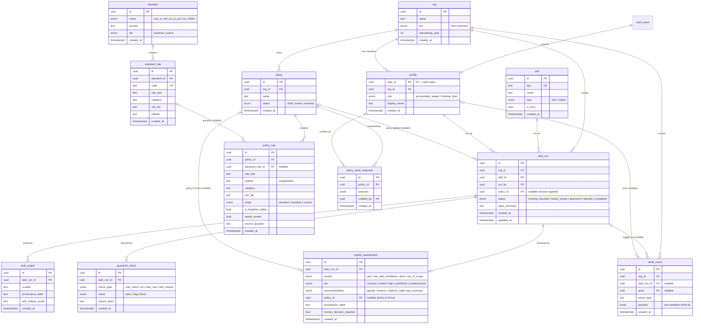

# Database diagram (ERD) — Community AI Workflow Studio (Release 1a)

Generated from the Supabase migrations in `studio/supabase/migrations/`. All org-scoped tables are
isolated by default-deny Row-Level Security on `current_org_id()` (ADR-0013 / ADR-0007 / ADR-0009).
`task_output` has a 1:1 relationship with `task_run` in practice; `audit_event` is append-only.

## How to read it

- **Tenancy:** `org` is the tenant root — `profile`, `policy`, `task_run`, and `audit_event` all
  carry `org_id`, and RLS keys every read/write on the signed-in user's org.
- **Governance flow:** a `task_run` ties together *who* (`run_by` -> `profile`), *what* (`skill`),
  and *which rules* (`policy_id`, the version applied); it produces a `task_output` (with its
  provenance label), is `guardrail_check`-ed, and is recorded in the append-only `audit_event` log.
- **Grounding:** each `policy_rule` optionally cites the `standard_rule` it derives from (snapshotted
  `citation`), so policy advice traces back to NIST / EU AI Act / ISO 42001.
- **Co-Pilot:** a `copilot_assessment` is the immutable result a Governance Co-Pilot run produces —
  its verdict, risk tier, grounded recommendation, and whether a human must decide.
- `auth_users` is Supabase Auth's managed table; `profile` extends it 1:1.

## Notes

- `task_output` is modeled one-to-many to `task_run` but is 1:1 in practice.
- `guardrail_check` has a reserved (not-yet-added) `policy_rule_id` hook for Epic 5's rule-check.
- `copilot_assessment` is the Co-Pilot's immutable result record — a child of `task_run`, one per
  Co-Pilot run (built; ADR-0010, migration `20261114010000`). Design rationale:
  `docs/design/epic-4-copilot-design.md`.
